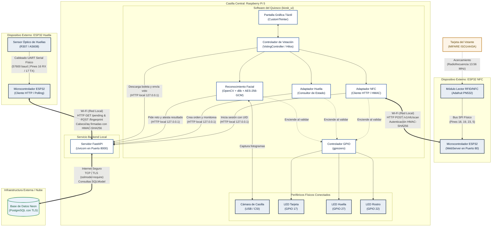
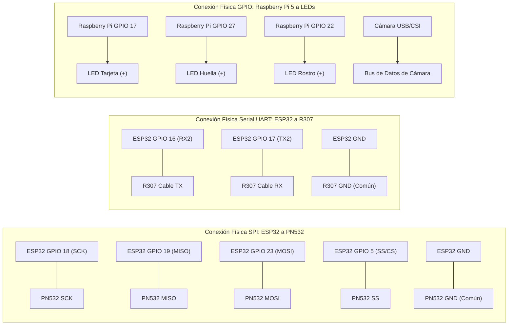
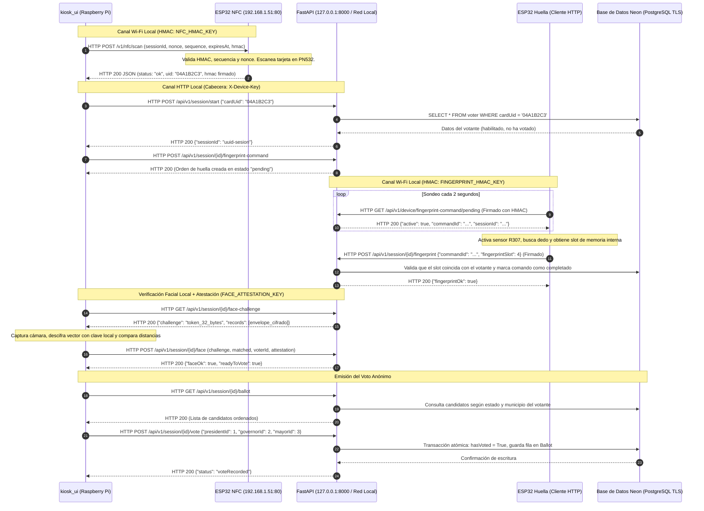
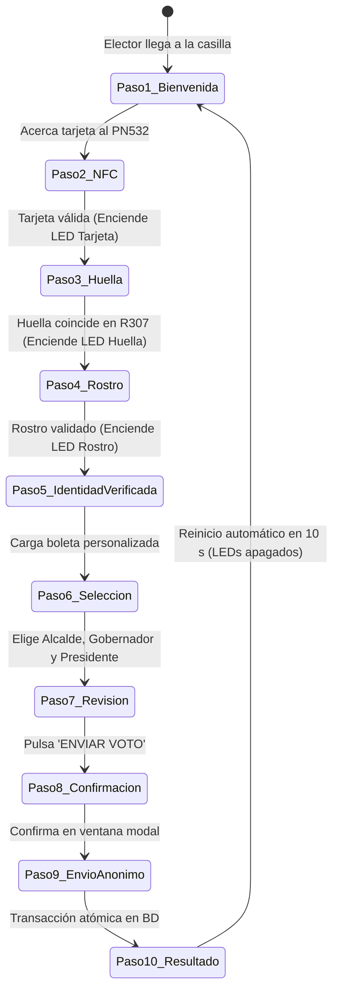

# Arquitectura Técnica y Conexiones del Sistema de Votación Electrónica

**Fecha de análisis:** 16 de noviembre de 2026  
**Proyecto:** Sistema de votación electrónica con triple verificación (NFC + Huella + Rostro)  
**Versión de análisis:** Código fuente base (`sistema_votacion2`)

---

## 1. Resumen General del Sistema

El proyecto es un **sistema de votación electrónica presencial (quiosco)** diseñado para garantizar elecciones seguras, auditables y anónimas mediante tres factores obligatorios de autenticación en cascada:

1. **Factor 1 (Posesión):** Tarjeta de votante con chip de proximidad (NFC / RFID).
2. **Factor 2 (Biometría dactilar):** Huella dactilar capturada en un sensor óptico independiente.
3. **Factor 3 (Biometría facial):** Reconocimiento facial local con cámara mediante visión por computadora y comparación matemática de vectores (sin almacenar fotografías).

### Principios Fundamentales del Diseño:
* **Separación física e inalámbrica:** Los sensores biométricos externos no están conectados por cable USB o serial a la computadora principal. Cada sensor es administrado por su propio microcontrolador **ESP32** independiente, comunicándose por **Wi-Fi** mediante peticiones HTTP firmadas criptográficamente con **HMAC-SHA256**.
* **Protección contra repetición (Anti-Replay):** Cada mensaje inalámbrico incluye números de un solo uso (*nonces*), secuencias numéricas estrictamente crecientes persistidas en memoria no volátil y ventanas de expiración con sincronización horaria por protocolo NTP.
* **Privacidad y secreto del voto:** La interfaz gráfica nunca muestra nombres de votantes, números de tarjeta (UID), ni datos biométricos. Al emitir el voto, este se registra de forma disociada (anónima) en la base de datos sin ningún vínculo con la identidad del votante ni con la sesión.

---

## 2. Inventario de Dispositivos y Componentes

A partir exclusivamente de la inspección de archivos de código (`.py`, `.ino`, `.h`, `.md`), se identifican los siguientes elementos:

| Dispositivo / Componente | Naturaleza | Función Principal | Información que Recibe | Información que Envía | Componentes con los que se Comunica |
| :--- | :--- | :--- | :--- | :--- | :--- |
| **Raspberry Pi (Raspberry Pi 5)** | Computadora de placa única (SBC) | Núcleo de la casilla: ejecuta la interfaz de usuario (`kiosk_ui`), la API backend local (`FastAPI`), el algoritmo facial y los LEDs indicadores. | Respuestas HTTP de las ESP32; fotogramas de la cámara; pulsaciones en pantalla táctil; datos de la base de datos Neon. | Órdenes HTTP firmadas a la ESP32 NFC; respuestas HTTP firmadas a la ESP32 de huella; señales eléctricas a los LEDs; consultas SQL a Neon. | ESP32 NFC, ESP32 Huella, Cámara, LEDs indicadores, Pantalla táctil, Base de datos Neon. |
| **Microcontrolador ESP32 NFC** | Microcontrolador embebido | Servidor HTTP local dedicado a controlar el lector PN532. No lee tarjetas si no recibe una orden previa autorizada. | Petición HTTP `POST /v1/nfc/scan` desde la Raspberry Pi con firma HMAC, identificador de sesión y nonce. | Respuesta HTTP firmada con estado de lectura y UID de la tarjeta detectada. | Módulo lector PN532 (físico por bus SPI); Raspberry Pi (inalámbrico por Wi-Fi). |
| **Módulo Lector NFC (Adafruit PN532)** | Periférico / Sensor de radiofrecuencia | Lee pasivamente el identificador único (UID) de tarjetas inteligentes compatibles con ISO/IEC 14443A (MIFARE). | Señales de reloj y control SPI de la ESP32 NFC; ondas de radiofrecuencia de tarjetas cercanas. | Datos en bruto del UID leído hacia la ESP32 NFC por el bus SPI. | Microcontrolador ESP32 NFC (mediante bus SPI). |
| **Microcontrolador ESP32 Huella** | Microcontrolador embebido | Cliente HTTP autónomo que consulta a la API si hay órdenes de huella pendientes, activa el sensor R307 y reporta el resultado. | Respuesta HTTP de la API con identificador de orden (`commandId`) y sesión; respuestas UART del sensor de huella. | Peticiones HTTP firmadas de consulta (`GET /pending`) y de resultado (`POST /fingerprint` con slot encontrado). | Sensor R307/AS608 (físico por UART); Raspberry Pi / FastAPI (inalámbrico por Wi-Fi). |
| **Sensor de Huella Óptico (R307 / AS608)** | Sensor biométrico físico | Captura la imagen del dedo, la procesa, extrae minucias y busca coincidencia en su memoria interna de plantillas. | Comandos seriales UART desde la ESP32 Huella (capturar, convertir a plantilla, buscar). | Códigos de respuesta y número de posición de memoria (*slot*) coincidente hacia la ESP32. | Microcontrolador ESP32 Huella (mediante puerto serie UART). |
| **Cámara Digital (USB / CSI)** | Sensor óptico de imagen | Captura en vivo el rostro del votante frente a la casilla. | Parámetros de captura y control de fotogramas desde la librería OpenCV. | Flujo de fotogramas de video digitales en resolución 1280x720 hacia la Raspberry Pi. | Raspberry Pi (a través de OpenCV `cv2.VideoCapture`). |
| **Indicadores LED (3 diodos luminosos)** | Actuadores / Periféricos visuales | Confirman visualmente al votante y operadores el éxito de cada paso de identificación (Tarjeta, Huella, Rostro). | Señal eléctrica de activación (HIGH / LOW) proveniente de los pines GPIO de la Raspberry Pi. | Emisión de luz indicadora hacia el exterior de la casilla. | Pines GPIO 17, 27 y 22 de la Raspberry Pi. |
| **Base de Datos PostgreSQL (Neon)** | Servidor de base de datos en la nube | Almacenamiento persistente del padrón electoral, candidatos registrados, sesiones activas, control anti-replay y votos anónimos. | Consultas SQL (SELECT, INSERT, UPDATE) a través de conexión cifrada TLS desde FastAPI. | Registros tabulares de votantes, candidatos y confirmaciones de escritura de voto. | Servidor FastAPI en la Raspberry Pi. |
| **Interfaz de Usuario (`kiosk_ui`)** | Aplicación gráfica de software (Python/CustomTkinter) | Pantalla táctil que guía al votante en 4 pasos: Bienvenida, Identificación, Selección de candidatos, Revisión y Confirmación. | Eventos táctiles del usuario; notificaciones de cambio de estado desde el controlador de votación. | Llamadas de inicio de pasos biométricos y envío final del voto hacia los adaptadores. | Controlador de votación `VotingController` y pantalla física. |
| **API Backend (`FastAPI` en `backend.py`)** | Servidor de servicios web local | Coordina la lógica de negocio, valida firmas HMAC, gestiona el ciclo de vida de las sesiones y procesa la boleta. | Peticiones HTTP locales del quiosco; peticiones HTTP firmadas de la ESP32 de huella. | Respuestas HTTP en formato JSON con estados de sesión, desafíos y boletas filtradas. | `kiosk_ui`, ESP32 Huella, Base de Datos Neon. |

---

## 3. Diagrama Principal de Arquitectura

El siguiente diagrama detalla la infraestructura física, los canales de comunicación y la distribución de componentes del sistema.

---

## 4. Diagramas Complementarios de Detalle

### Diagrama Complementario A: Conexiones Físicas y Cableado de Pines

Muestra exclusivamente cómo están interconectados físicamente los circuitos electrónicos, sensores y diodos:

---

### Diagrama Complementario B: Flujo de Comunicaciones y Protocolos de Red

Muestra los puertos de red, verbos HTTP y endpoints utilizados por cada canal inalámbrico:

---

## 5. Explicación Sencilla de Cada Conexión para Personas No Técnicas

A continuación se explica cada enlace del sistema en un lenguaje comprensible para cualquier integrante del equipo, respondiendo a cuatro preguntas clave:

---

### Conexión 1: Tarjeta del Votante → Lector PN532
* **¿Cómo se conectan?**
  Sin contacto físico. Funciona por proximidad mediante ondas de radiofrecuencia (tecnología NFC a 13.56 MHz) cuando el votante acerca su credencial a unos 2 a 5 centímetros del lector.
* **¿Qué información intercambian?**
  La tarjeta únicamente entrega su número de serie de fábrica (llamado UID, un código identificador único de entre 8 y 20 caracteres). La tarjeta no entrega nombres ni datos personales.
* **¿Para qué sirve esta comunicación?**
  Para iniciar el proceso electoral e identificar qué votante se está presentando en la casilla.
* **¿Qué sucede cuando se interrumpe?**
  Si el votante aleja la tarjeta antes de tiempo, el lector agota su tiempo de espera (20 segundos) y la pantalla le solicita volver a acercarla con calma.

---

### Conexión 2: Lector PN532 → Microcontrolador ESP32 NFC
* **¿Cómo se conectan?**
  Mediante cuatro cables físicos soldados o conectados en placa (bus industrial SPI: pines 18, 19, 23 y 5 de la ESP32) más tierra común (GND).
* **¿Qué información intercambian?**
  La ESP32 le envía órdenes al chip lector para activar la antena y consultar si hay una tarjeta en el campo; el lector le responde con el código de la tarjeta detectada.
* **¿Para qué sirve esta comunicación?**
  Permite que la ESP32 controle directamente el sensor físico y lea el número de la credencial.
* **¿Qué sucede cuando se interrumpe?**
  Si se desconecta algún cable, la ESP32 detecta que el lector no responde y la pantalla muestra un mensaje de advertencia indicando que el lector no está disponible.

---

### Conexión 3: Raspberry Pi (Adaptador NFC) → Microcontrolador ESP32 NFC
* **¿Cómo se conectan?**
  De manera inalámbrica a través de la red Wi-Fi local de la casilla, utilizando mensajes web seguros (HTTP POST firmado con clave secreta HMAC-SHA256).
* **¿Qué información intercambian?**
  La Raspberry Pi envía una orden de: *"Actívate y lee una tarjeta durante los próximos 20 segundos"*. La ESP32 responde: *"Aquí está la tarjeta leída y este mensaje viene firmado por mí"*.
* **¿Para qué sirve esta comunicación?**
  Evita que el lector NFC esté leyendo tarjetas por su cuenta. Solo lee cuando la computadora central lo autoriza explícitamente al iniciar una sesión.
* **¿Qué sucede cuando se interrumpe?**
  Si se pierde la señal Wi-Fi, la Raspberry Pi no puede iniciar la sesión del votante y le pide al elector reintentar o llamar al personal de casilla.

---

### Conexión 4: Sensor R307/AS608 → Microcontrolador ESP32 Huella
* **¿Cómo se conectan?**
  A través de cables de comunicación serial (UART): el cable de transmisión del sensor va al pin 16 de la ESP32, y el de recepción va al pin 17, operando a 57,600 baudios.
* **¿Qué información intercambian?**
  La ESP32 le ordena al sensor: *"Captura la imagen del dedo y busca en tu memoria a quién pertenece"*. El sensor responde con el número de posición de memoria (*slot*) donde encontró la huella.
* **¿Para qué sirve esta comunicación?**
  Para digitalizar la huella dactilar y comprobar si coincide con alguna de las registradas previamente.
* **¿Qué sucede cuando se interrumpe?**
  Si los cables se sueltan o fallan, la ESP32 no detecta el sensor óptico y cancela la operación de forma segura sin descontarle intentos al votante.

---

### Conexión 5: Microcontrolador ESP32 Huella → Servidor FastAPI (Raspberry Pi)
* **¿Cómo se conectan?**
  De forma inalámbrica mediante la red Wi-Fi local de la casilla electoral, usando peticiones HTTP autenticadas con una clave secreta propia en las cabeceras.
* **¿Qué información intercambian?**
  La ESP32 pregunta periódicamente: *"¿Hay alguna orden de huella en espera?"*. Cuando la hay, recibe la orden, toma la huella y le responde al servidor: *"El votante puso el dedo y corresponde al registro número X"*.
* **¿Para qué sirve esta comunicación?**
  Permite que el sensor de huella esté físicamente separado de la computadora central sin cables estorbosos, manteniendo una comunicación sellada contra manipulaciones.
* **¿Qué sucede cuando se interrumpe?**
  Si falla el Wi-Fi mientras se lee la huella, la ESP32 conserva el resultado en su memoria y reintenta enviarlo automáticamente sin obligar al votante a colocar el dedo otra vez.

---

### Conexión 6: Cámara Digital → Módulo de Reconocimiento Facial (Raspberry Pi)
* **¿Cómo se conectan?**
  Mediante cable físico USB estándar o cable plano flexible para cámara (interfaz CSI) conectado directamente a la placa Raspberry Pi.
* **¿Qué información intercambian?**
  La cámara envía imágenes en vivo (fotogramas de video a 1280x720 píxeles). El software lee un fotograma a la vez en la memoria RAM temporal.
* **¿Para qué sirve esta comunicación?**
  Para detectar el rostro del elector, verificar que haya exactamente una persona frente a la casilla y calcular matemáticamente su patrón facial.
* **¿Qué sucede cuando se interrumpe?**
  Si la cámara se desconecta o no hay suficiente iluminación, el sistema avisa en pantalla: *"No se pudo acceder a la cámara"* o *"No se reconoció el rostro"* para que el votante se acomode y reintente.

---

### Conexión 7: Raspberry Pi → Diodos LED Indicadores (Tarjeta, Huella, Rostro)
* **¿Cómo se conectan?**
  Mediante cables eléctricos directos desde los pines digitales GPIO (17, 27 y 22) de la Raspberry Pi hacia los polos positivos de tres diodos LED, aterrizados a tierra común.
* **¿Qué información intercambian?**
  No transmiten datos binarios, sino pulsos eléctricos de encendido (3.3V) y apagado (0V) controlados por la librería de software `gpiozero`.
* **¿Para qué sirve esta comunicación?**
  Proporciona una confirmación visual física e inmediata (luces testigo) de que cada paso biométrico fue aprobado con éxito.
* **¿Qué sucede cuando se interrumpe?**
  Si un cable se desconecta o un LED se quema, el proceso de votación en pantalla continúa funcionando normalmente, pues la lógica principal reside en el software; únicamente se pierde el indicador visual luminoso externo.

---

### Conexión 8: Interfaz Gráfica (`kiosk_ui`) ↔ Servidor Local (`FastAPI`)
* **¿Cómo se conectan?**
  Comunicación interna de software dentro de la misma Raspberry Pi a través de la dirección de red local interna `127.0.0.1` (puerto 8000) usando llamadas HTTP/JSON.
* **¿Qué información intercambian?**
  La interfaz solicita: abrir sesión con una tarjeta, crear órdenes de huella, solicitar desafíos faciales, descargar la lista de candidatos que le corresponden al votante y finalmente enviar los votos seleccionados.
* **¿Para qué sirve esta comunicación?**
  Garantiza una arquitectura limpia: la interfaz de pantalla solo se encarga de dibujar botones y tarjetas, mientras que FastAPI concentra todas las reglas electorales, validaciones de seguridad y bases de datos.
* **¿Qué sucede cuando se interrumpe?**
  Si el servidor local FastAPI se detiene, la interfaz muestra de inmediato: *"El servicio local de validación no está disponible"* y bloquea cualquier intento de voto.

---

### Conexión 9: Servidor FastAPI (Raspberry Pi) ↔ Base de Datos en la Nube (Neon)
* **¿Cómo se conectan?**
  A través de Internet utilizando una conexión de red cifrada con grado bancario (protocolo TCP sobre TLS con certificado de seguridad obligatorio).
* **¿Qué información intercambian?**
  FastAPI envía consultas para comprobar que el votante esté en el padrón y no haya votado previamente; al terminar, envía una orden para marcar que el votante ya participó y deposita el voto en una urna digital anónima.
* **¿Para qué sirve esta comunicación?**
  Mantiene centralizado el padrón electoral oficial y almacena los sufragios de forma permanente y segura contra pérdidas de energía eléctrica local.
* **¿Qué sucede cuando se interrumpe?**
  Si se corta la conexión a Internet, la casilla detiene la admisión de nuevos votos para evitar que una persona pueda votar dos veces o que un voto quede en el limbo.

---

## 6. Descripción del Flujo General de Funcionamiento

El ciclo de vida de un voto completo transcurre en **4 fases estrictamente secuenciales**:

1. **Paso 1: Bienvenida y Detección de Tarjeta**
   * La pantalla invita al elector a acercar su credencial.
   * La Raspberry Pi envía una orden firmada por Wi-Fi a la **ESP32 NFC**.
   * El votante acerca su tarjeta al módulo **PN532**, se lee el UID y se devuelve firmado a la Raspberry Pi.
   * La Raspberry Pi verifica la tarjeta con el backend y enciende el **LED de Tarjeta (GPIO 17)**.

2. **Paso 2: Comprobación de Huella Dactilar**
   * El quiosco genera una orden de verificación de huella de un solo uso.
   * La **ESP32 Huella**, que está consultando por Wi-Fi a la API cada 2 segundos, detecta la orden y activa el sensor **R307**.
   * El votante apoya su dedo en el sensor óptico durante 10 segundos.
   * El sensor identifica la posición de memoria interna (*slot*) y la ESP32 la envía firmada por Wi-Fi al backend.
   * Si el número coincide exactamente con el registrado para ese votante, se aprueba el paso y se enciende el **LED de Huella (GPIO 27)**.

3. **Paso 3: Verificación Facial Local**
   * El backend entrega un desafío criptográfico de un solo uso y el registro facial cifrado (*envelope*) correspondiente exclusivamente a ese votante.
   * La **cámara** conectada a la Raspberry Pi toma una imagen del votante.
   * El algoritmo local comprueba que haya exactamente una persona, descifra el vector patrón con la clave local (AES-256-GCM) y calcula la distancia matemática entre ambos rostros.
   * Si coincide, la Raspberry Pi firma una prueba atestada (`attestation`) hacia el backend y enciende el **LED de Rostro (GPIO 22)**.
   * La pantalla cambia a una confirmación totalmente neutra: *"Identidad verificada correctamente"*.

4. **Paso 4: Elección de Candidatos, Revisión y Voto Seguro**
   * El quiosco descarga la boleta electoral filtrada por el estado y municipio del elector.
   * El votante elige sus opciones en 3 cargos obligatorios: **Alcalde → Gobernador → Presidente**.
   * Pasa a la pantalla de revisión donde visualiza el nombre, foto neutral en gris y **partido político** de sus selecciones.
   * Al pulsar **"ENVIAR VOTO"**, una **ventana modal integrada** le pide confirmar: *«¿Está seguro de su decisión? Una vez enviado, su voto no podrá modificarse ni cancelarse»*.
   * Al confirmar, se envía la selección al backend. En una sola transacción indivisible:
     - Se marca al votante con `hasVoted = True` (para impedir cualquier segundo intento).
     - Se insertan los votos de manera totalmente desvinculada en la tabla `Ballot`.
   * La pantalla muestra el comprobante de éxito y una cuenta regresiva de 10 segundos para reiniciar el quiosco y apagar los 3 LEDs para el siguiente ciudadano.

---

## 7. Tabla de Protocolos y Tecnologías Utilizadas

| Tecnología / Protocolo | Capa / Ámbito | Dispositivos Involucrados | Función en el Proyecto | Nivel de Seguridad |
| :--- | :--- | :--- | :--- | :--- |
| **SPI (Serial Peripheral Interface)** | Físico / Cableado (Hardware) | ESP32 NFC ↔ Lector PN532 | Comunicación síncrona de alta velocidad para leer el chip de proximidad. | Bus local cableado directo en placa. |
| **UART (Universal Asynchronous Receiver-Transmitter)** | Físico / Cableado (Hardware) | ESP32 Huella ↔ Sensor R307 | Transmisión serial asíncrona a 57,600 baudios para comandar el sensor biométrico. | Canal serial punto a punto aislado. |
| **GPIO Digital (General Purpose Input/Output)** | Físico / Eléctrico | Raspberry Pi 5 ↔ 3 Diodos LED | Activación mediante voltaje (3.3V) de los indicadores de estatus físico. | Circuito cableado en placa. |
| **Wi-Fi (802.11 b/g/n en 2.4 GHz)** | Enlace Inalámbrico | Raspberry Pi ↔ ESP32 NFC y ESP32 Huella | Conexión de red de área local (LAN) para interconectar los microcontroladores. | WPA2 / WPA3 Personal o Empresarial en red aislada. |
| **HTTP sobre TCP (Puerto 80 y 8000)** | Aplicación / Red Local | Raspberry Pi ↔ ESP32s | Transporte de mensajes REST en formato JSON. | Sin cifrado de transporte; reforzado a nivel de aplicación con HMAC. |
| **HMAC-SHA256 (Hash-based Message Authentication Code)** | Seguridad de Aplicación | Entre todos los nodos de red local | Autenticación de origen, integridad estricta del mensaje y protección anti-manipulación. | Claves simétricas independientes de 32 bytes (256 bits). |
| **Anti-Replay (Nonces + Secuencias crecientes)** | Seguridad de Sesión | ESP32s y Base de Datos | Impide que un atacante capture un mensaje legítimo en la red y lo retransmita para validar una identidad falsa. | Nonces aleatorios únicos + secuencias guardadas en memoria Flash. |
| **AES-256-GCM** | Criptografía Simétrica de Datos | Raspberry Pi (Memoria local) | Cifrado autenticado de los vectores faciales en reposo y en tránsito hacia la base de datos. | Grado militar con vector de inicialización (nonce de 12 bytes) y tag de integridad de 16 bytes. |
| **TCP / TLS (Transport Layer Security)** | Transporte Seguro de Internet | FastAPI ↔ Base de Datos Neon | Túnel cifrado para todas las transacciones SQL hacia la nube (`sslmode=require`). | TLS 1.3 con certificados de autoridad pública verificados. |
| **NTP (Network Time Protocol)** | Sincronización Horaria | ESP32s y Raspberry Pi | Sincronización del reloj interno con servidores de hora en Internet (`pool.ntp.org`) para validar expiración de órdenes. | Control de ventanas de tiempo con margen máximo de 120 segundos. |

---

## 8. Lista de Conexiones Confirmadas y Pendientes de Verificar

Para garantizar la honestidad técnica del informe, se clasifica cada aspecto según su grado de comprobación en el código fuente:

### Conexiones y Parámetros 100% Confirmados en el Código:
1. **Asignación de Pines SPI del PN532:** SCK en pin 18, MISO en 19, MOSI en 23 y SS en 5 (definidos en [firmware/nfc_esp32/nfc_esp32.ino](file:///c:/Users/yared/Documents/FastAPI/sistema_votacion2/firmware/nfc_esp32/nfc_esp32.ino#L13-L16)).
2. **Asignación de Pines UART del Sensor de Huella:** RX en pin 16 y TX en pin 17 a 57,600 baudios (definidos en [firmware/fingerprint_esp32/fingerprint_esp32.ino](file:///c:/Users/yared/Documents/FastAPI/sistema_votacion2/firmware/fingerprint_esp32/fingerprint_esp32.ino#L21-L23)).
3. **Pines de los LEDs en Raspberry Pi:** Tarjeta en GPIO 17, Huella en GPIO 27 y Rostro en GPIO 22 (definidos en [kiosk_ui/led_control.py](file:///c:/Users/yared/Documents/FastAPI/sistema_votacion2/kiosk_ui/led_control.py#L5-L7)).
4. **Endpoints y firmas de la ESP32 NFC:** Endpoint `POST /v1/nfc/scan` con esquema `nfc-command-v1` y `nfc-response-v1`.
5. **Endpoints y firmas de la ESP32 Huella:** Sondeo en `GET /api/v1/device/fingerprint-command/pending` y reporte en `POST /api/v1/session/{sessionId}/fingerprint` con esquema `esp32-request-v1`.
6. **Desconexión Serial/USB de las ESP32 hacia la Pi:** Confirmado documental y técnicamente; los puertos seriales USB de las ESP32 solo imprimen trazas de texto para el monitor de la computadora de desarrollo, no constituyen canales de datos hacia la Raspberry Pi.

### Aspectos Pendientes de Verificación Física o No Documentados en Código:
1. **Voltaje y alimentación eléctrica de los sensores:** El código advierte explícitamente: *«Revisa la alimentación indicada por tu modelo; no todos admiten 3.3V ni tienen los mismos colores de cables»*. La fuente de alimentación (si el PN532 y el R307 se alimentan a 3.3V o 5V desde la ESP32 o desde una fuente externa) depende del circuito físico montado en la casilla y no está fijada por software.
2. **Tipo de cámara física:** El código utiliza `cv2.VideoCapture(camera_index)` con resolución fijada en 1280x720. Esto confirma compatibilidad con cualquier cámara web USB estándar o cámara Raspberry Pi (CSI) configurada como dispositivo V4L2 en el sistema operativo, pero el modelo específico de cámara no está delimitado en el código.
3. **Mecanismo de red Wi-Fi en producción:** En el código de firmware las credenciales de Wi-Fi se leen desde un archivo de cabecera `secrets.h`. No existe en el código un portal cautivo (*WiFiManager*) para cambiar de red en campo sin recompilar el firmware.
4. **Dirección IP fija de la ESP32 NFC:** El adaptador de la Raspberry Pi tiene por defecto `http://192.168.1.51` o la variable `NFC_ESP32_URL`. Si el router de la casilla cambia la IP por DHCP, la comunicación se interrumpirá a menos que se configure una reserva de dirección MAC en el router o se defina la variable de entorno.

---

*Documento técnico elaborado a partir de la auditoría completa de los archivos del repositorio.*
