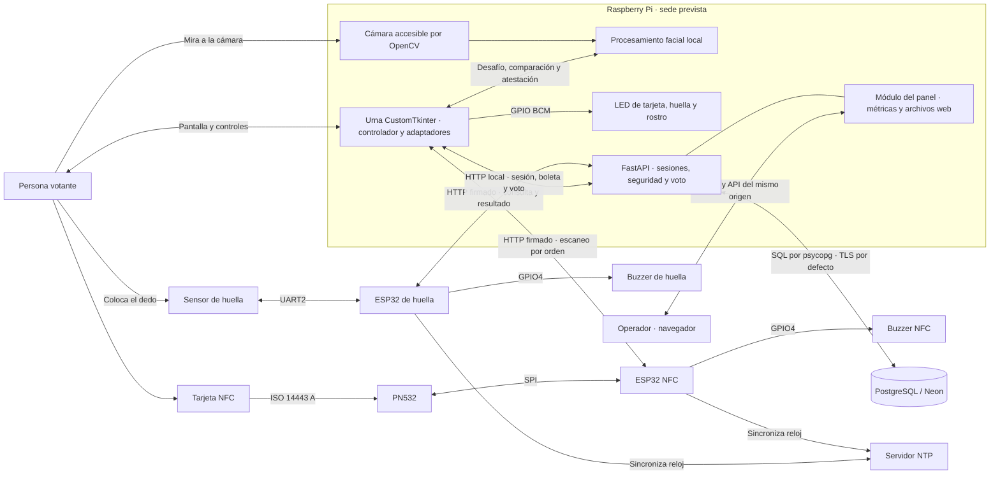

# 02 · Arquitectura general

La Raspberry Pi es la sede prevista de la interfaz de votación, la cámara y FastAPI. Cada ESP32 atiende su propio lector en la red de la casilla. PostgreSQL guarda los datos y el navegador del operador recibe reportes desde FastAPI. El diagrama representa la topología prevista por el código y las guías de despliegue. [Arquitectura previa](ARQUITECTURA.md) · [Despliegue real](../GUIA_DESPLIEGUE_REAL.md)

## Responsabilidades y ubicación

| Componente | Responsabilidad | Evidencia |
| --- | --- | --- |
| Urna | Muestra estados, solicita verificaciones, controla los LED y mantiene la selección en memoria hasta el envío. | [Entrada](../kiosk_ui/main.py) · [Controlador](../kiosk_ui/core/controller.py) |
| ESP32 NFC | Lee el UID por SPI durante un escaneo solicitado y emite retroalimentación sonora al obtener un UID válido. | [Firmware NFC](../firmware/nfc_esp32/nfc_esp32.ino) |
| ESP32 de huella | Consulta la orden, coordina el sensor UART, reporta el slot o un fallo y controla el buzzer. | [Firmware de huella](../firmware/fingerprint_esp32/fingerprint_esp32.ino) |
| Reconocimiento facial en la Pi | Captura, genera el vector, descifra el registro y compara. La API verifica la atestación devuelta por la urna. | [Captura y comparación](../face_local.py) · [Adaptador](../kiosk_ui/adapters/real/biometrics.py) |
| FastAPI | Autoriza transiciones, prepara la boleta, persiste el voto, protege el bloqueo y sirve la API de administración. | [Backend](../backend.py) · [Módulo del panel](../dashboard_api.py) |
| PostgreSQL / Neon | Conserva padrón, candidaturas, selecciones, sesiones y datos operativos. | [Modelos y motor](../backend.py) · [Tablas del panel](../dashboard_api.py) |
| Navegador | Abre el panel React, consulta datos periódicamente y solicita las exportaciones. | [Aplicación](../dashboard/src/App.tsx) · [Cliente](../dashboard/src/api.ts) |

La detección de tarjeta y el reconocimiento de huella se ejecutan cerca de sus lectores. La comparación facial y las reglas electorales corren en procesos de la Pi según el despliegue previsto. Neon concentra la persistencia remota y el navegador presenta agregados. El modo demo reemplaza los servicios del controlador por dobles dentro del mismo proceso y puede ejecutarse sin red ni base. [Servicios reales](../kiosk_ui/adapters/real/services.py) · [Servicios simulados](../kiosk_ui/adapters/mock.py)

## Recorrido de la información

1. El PN532 observa el UID y el adaptador valida la respuesta de su ESP32. FastAPI busca el UID y genera una sesión vinculada al padrón.
2. FastAPI crea una orden de huella. El ESP32 consulta la API y el módulo dactilar busca la coincidencia con sus plantillas internas. Solo retorna el identificador de slot o cero.
3. En la configuración predeterminada, FastAPI entrega el desafío facial y el registro cifrado asociado a la sesión. La urna compara localmente y envía una atestación vinculada al resultado.
4. La API devuelve candidaturas por región. La urna conserva las selecciones en memoria hasta que la persona confirma en el diálogo de envío. El backend guarda las selecciones y marca la participación.
5. El middleware registra el resultado técnico de determinadas peticiones autenticadas. El panel usa ese registro, el padrón, las selecciones y los latidos para mostrar indicadores. [Flujo y decisiones](03-sistemas-digitales.md) · [Modelo de datos](04-base-de-datos.md)
