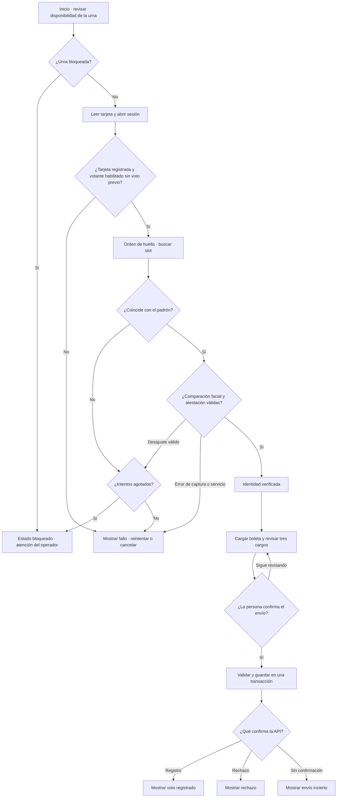
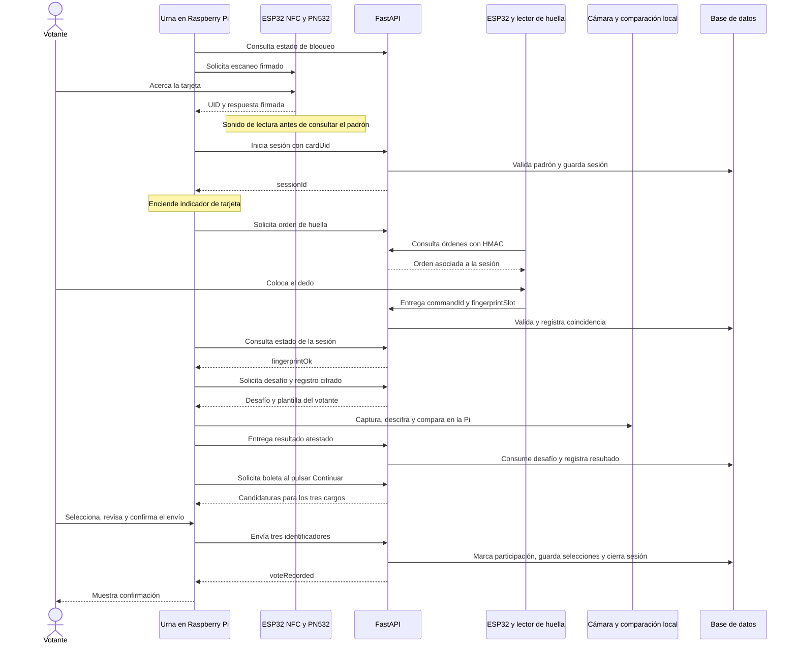

# 03 · Sistemas digitales

La urna avanza al siguiente paso cuando el controlador recibe un resultado válido. El backend también verifica las condiciones para cada operación. Esta segunda comprobación sostiene las reglas incluso si una interfaz solicita una acción fuera de orden. [Fases y modelos](../kiosk_ui/core/models.py) · [Controlador](../kiosk_ui/core/controller.py) · [Backend](../backend.py)

| Proceso | Entrada y validación | Estado o acción |
| --- | --- | --- |
| Acceso NFC | Disponibilidad de la urna, UID normalizado y padrón. | `startSession` crea un UUID con `cardOk=true`. La API rechaza tarjeta desconocida, persona deshabilitada o voto previo. |
| Huella | Orden ligada a la sesión, estado `pending`, vigencia, HMAC y `fingerprintSlot`. | `verifyFingerprint` reclama la orden una vez y guarda `matched` o `failed`. Un slot igual al del padrón activa `fingerprintOk`. Cinco fallos completados bloquean la urna. |
| Rostro | Desafío vigente de la sesión, resultado e identidad atestados. | `verifyFace` consume el desafío y activa `faceOk` o incrementa `faceAttempts`. El máximo predeterminado es cinco. |
| Habilitación de la boleta | `cardOk`, `fingerprintOk`, rostro válido o desactivado, y urna disponible. | `buildSessionStatus` calcula `readyToVote`. `getBallot` devuelve listas para municipio, estado y presidencia. |
| Envío del voto | Tres identificadores más la sesión activa. Valida habilitación, cargo, región y `hasVoted`. | `castVote` actualiza el padrón, inserta tres selecciones y cierra la sesión en el mismo commit. |
| Cancelación o vencimiento | Cancelación desde la interfaz o sesión mayor a 300 s por defecto. | La API cierra la sesión e invalida órdenes pendientes. La cancelación local intenta notificar al servidor. |
| Bloqueo y recuperación | Agotamiento de intentos o solicitud manual autenticada. | `lock_kiosk_device` cierra sesiones abiertas y cancela órdenes, guarda un incidente y bloquea operaciones de voto con 423. La recuperación usa una lectura firmada de tarjeta administrativa vinculada al incidente. |

El firmware de huella enrola una plantilla mediante dos lecturas con retiro del dedo entre ellas. En modo automático, solo activa una lectura después de recibir una orden. El ciclo espera retirar el dedo, toma la imagen, convierte y busca una plantilla, prepara el slot y entrega el resultado firmado. Su estado de entrega permite reintentos de transporte durante la ventana de la orden. [Firmware de huella](../firmware/fingerprint_esp32/fingerprint_esp32.ino)

## De la presentación de la tarjeta al resultado

La señal física del PN532 produce dos efectos. El firmware emite un sonido al completar la lectura y el adaptador activa el LED de tarjeta tras recibir la sesión que confirma el padrón. Si se pierde la respuesta al enviar el voto, `VotingApi` y `VotingController` muestran un resultado incierto e impiden repetir automáticamente la operación. [Adaptador NFC](../kiosk_ui/adapters/real/nfc.py) · [Cliente HTTP](../kiosk_ui/adapters/real/api_client.py) · [LED](../kiosk_ui/led_control.py)

`REQUIRE_FACE=false` cambia la regla de disponibilidad de boleta en FastAPI. El controlador actual intenta verificar el rostro después de la huella y el adaptador trata el rechazo del desafío deshabilitado como un error. La secuencia documentada usa la configuración predeterminada. [Adaptador biométrico](../kiosk_ui/adapters/real/biometrics.py) · [Regla de la API](../backend.py)

En un bloqueo por intentos con evidencia pendiente, el controlador intenta capturar un JPEG si han pasado como máximo 30 s desde el bloqueo. Da hasta 8 s a la captura y reutiliza su resultado en los reintentos de envío. Si la captura falla o el bloqueo es anterior, informa la indisponibilidad de la imagen. El bloqueo permanece aunque falle la cámara. La tarjeta administrativa habilitada permite volver a bienvenida y queda registrada en la auditoría. [Controlador](../kiosk_ui/core/controller.py) · [Seguridad de la urna](SEGURIDAD_KIOSK.md) · [Pruebas de bloqueo](../tests/test_security_kiosk.py)
