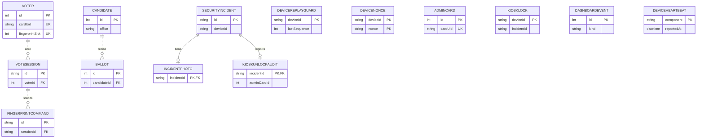

# 04 · Base de datos

El padrón identifica a las personas habilitadas. Las selecciones se guardan en otra tabla para que el resultado pueda contarse sin consultar la identidad del votante. La base también conserva sesiones, órdenes de huella, bloqueo y telemetría. [Modelos de votación](../backend.py) · [Modelos del panel](../dashboard_api.py)

## Motor y conexión

El despliegue previsto usa PostgreSQL en Neon mediante SQLModel, SQLAlchemy y el controlador psycopg. FastAPI lee `DATABASE_URL` al importar el módulo. Para PostgreSQL activa `pool_pre_ping`, aplica `DB_SSLMODE` con valor predeterminado `require` y limita a 10 s la conexión y la espera del pool. Cada petición obtiene su propia sesión ORM. SQLite admite ejecución local y se usa en las pruebas. La ruta del archivo depende de la URL. El backend habilita `check_same_thread=False` en SQLite y no configura allí `PRAGMA foreign_keys` de forma explícita. [Motor y sesiones](../backend.py) · [Dependencias](../requirements.txt)

El esquema se crea con `SQLModel.metadata.create_all` y el módulo del panel garantiza sus dos tablas al instalarse. Esta operación crea tablas ausentes. La actualización de estructuras ya existentes requiere revisar y aplicar una migración aparte. [Despliegue](09-guia-instalacion.md)

## Modelo entidad-relación

Las líneas representan claves foráneas declaradas. Las referencias de aplicación se indican debajo del diagrama.

`KioskLock.incidentId`, `KioskLock.unlockedByCardUid`, `KioskUnlockAudit.adminCardId` y `SecurityIncident.userRef` se resuelven en código y carecen de FK. En el incidente por intentos, `userRef` guarda la sesión. El nonce de huella y el de escaneo administrativo comparten tabla con identificadores de ámbito distintos. [Modelos y operaciones](../backend.py)

## Diccionario de tablas

Tipos lógicos del ORM: `str` corresponde a texto, `int` a entero, `bool` a booleano, `datetime` a fecha y hora y `bytes` a binario. **PK** identifica una fila, **FK** referencia otra tabla y **U** exige unicidad. **I** indica índice y **N** admite nulo, con valor inicial `None`. Las demás columnas son obligatorias salvo el ID entero generado. Los valores indicados son predeterminados del modelo o asignaciones de la aplicación, según se especifica.

| Tabla | Propósito | Columnas, valores y restricciones |
| --- | --- | --- |
| `voter` | Padrón y estado de participación. | `id:int PK` generado, `fullName:str`, `cardUid:str U I`, `fingerprintSlot:int U`, `faceEmbedding:str` (vacío si se da de alta sin rostro), `stateName:str I`, `municipalityName:str I`, `hasVoted:bool=false`, `isEnabled:bool=true`. |
| `candidate` | Catálogo regional por cargo. | `id:int PK` generado, `name:str`, `party:str N`, `office:str I`, `stateName:str N I`, `municipalityName:str N I`. Cargo y combinación geográfica validados por la API. |
| `votesession` | Sesión temporal de autenticación. | `id:str PK` UUID asignado por la API, `voterId:int FK → voter.id`, `cardOk:bool=true`, `fingerprintOk:bool=false`, `faceOk:bool=false`, `faceAttempts:int=0`, `faceChallenge:str N`, `isClosed:bool=false`, `createdAt:datetime`. |
| `fingerprintcommand` | Orden y resultado de una lectura. | `id:str PK` UUID de la API, `sessionId:str FK I → votesession.id`, `status:str I=pending`, `result:str N`, `fingerprintSlot:int N`, `createdAt:datetime`, `completedAt:datetime N`. El código usa `pending/completed/cancelled/expired` y `matched/failed`. |
| `devicereplayguard` | Última secuencia aceptada para huella. | `deviceId:str PK`, `lastSequence:int=0`, `updatedAt:datetime`. |
| `devicenonce` | Registro de nonces consumidos. | PK compuesta `deviceId:str` + `nonce:str`, `createdAt:datetime`. |
| `ballot` | Selección de una candidatura. | `id:int PK` generado, `candidateId:int FK → candidate.id`. Cada votación agrega tres filas. |
| `admincard` | Tarjetas NFC de desbloqueo. | `id:int PK` generado, `cardUid:str U I`, `adminName:str=Administrador`, `isEnabled:bool=true`, `createdAt:datetime`, `updatedAt:datetime N`. |
| `kiosklock` | Estado persistente de la urna. | `deviceId:str PK`, `isLocked:bool=false`, `lockedAt:datetime N`, `reason:str N`, `lockedByAttemptType:str N`, `incidentId:str N`, `unlockedAt:datetime N`, `unlockedByCardUid:str N`. |
| `securityincident` | Motivo y estado de la evidencia. | `id:str PK` UUID de la API, `deviceId:str I`, `timestamp:datetime`, `authType:str`, `eventType:str`, `userRef:str N`, `photoPath:str N`, `status:str=OPEN`, `details:str N`. `photoPath` permanece en el modelo. La ruta activa guarda el JPEG en `incidentphoto`. |
| `incidentphoto` | Evidencia JPEG del incidente. | `incidentId:str PK FK → securityincident.id`, `jpeg:bytes`, `capturedAt:datetime I`. |
| `kioskunlockaudit` | Auditoría de desbloqueo por incidente. | `incidentId:str PK FK → securityincident.id`, `adminCardId:int`, `scanNonce:str`, `adminName:str`, `unlockedAt:datetime`. |
| `dashboardevent` | Evento técnico para reportes. | `id:int PK` generado, `createdAt:datetime I` (UTC sin zona), `kind:str I`, `device:str`, `status:str`. |
| `deviceheartbeat` | Último reporte por componente. | `component:str PK`, `status:str`, `reportedAt:datetime` (UTC sin zona). |

## Operaciones y justificación

| Operación | Implementación |
| --- | --- |
| Enrolar y consultar | `enrollVoter`, `listVoters` y `enrollFace` dan de alta, listan y actualizan el padrón. La unicidad de UID y slot rechaza duplicados. `createCandidate` y `listCandidates` gestionan el catálogo expuesto. `enrollAdminCard` inserta o actualiza por UID. |
| Verificar | `startSession` crea la sesión. `requestFingerprintCommand` crea o recupera una orden pendiente. `verifyFingerprint` y `verifyFace` reclaman condicionalmente la orden pendiente y el desafío vigente, respectivamente. `verifyFingerprintDevice` confirma secuencia y nonce antes de ejecutar la ruta. |
| Emitir voto | `castVote` actualiza `hasVoted` solo si todavía es falso. Inserta tres filas y cierra la sesión en la misma transacción. Los duplicados se rechazan durante el inicio o durante el registro. |
| Consultar reportes | `getResults` y `build_results` cuentan filas por candidatura con unión externa para incluir candidaturas sin votos. El panel calcula porcentajes por grupo de cargo y región. `build_participation` usa personas del padrón, y la serie del panel usa eventos de voto exitosos. |
| Bloquear y recuperar | `lock_kiosk_device`, `unlockKiosk` y `reportSecurityIncident` crean y actualizan bloqueo, incidente, evidencia y auditoría. La PK por incidente limita a una foto y una auditoría asociadas. |
| Retener o eliminar | `purgeExpiredPhotos` elimina fotos vencidas por solicitud administrativa. El middleware poda eventos antiguos durante el registro de nuevos eventos, con revisión como máximo aproximadamente cada hora por proceso. Cancelar una sesión la cierra sin borrar su historial. |

Separar candidaturas de selecciones evita repetir nombre y partido en cada voto. Separar órdenes de sesiones representa los múltiples intentos sin columnas duplicadas por intento. Estado y municipio son texto normalizado en padrón y catálogo. El código aplica sus dependencias geográficas, sin catálogos referenciados ni restricciones SQL por cargo. El nombre administrativo se copia a la auditoría para conservar lo registrado al desbloquear. `hasVoted` conserva el hecho de participación sin enlazar las tres filas de selección. Estos rasgos describen qué redundancias se reducen y dónde persiste texto duplicado, sin certificar una forma normal del conjunto. [Reglas regionales y transacciones](../backend.py)

## Privacidad e integridad

Las plantillas de huella residen en el lector, mientras el padrón guarda el slot. El vector facial se cifra en la Pi con AES-256-GCM y el backend valida el formato del contenedor. Durante la verificación facial entrega solo el registro cifrado de la persona de la sesión. La evidencia JPEG de un incidente se guarda en la base con acceso administrativo y `Cache-Control: no-store`. Su periodo predeterminado es de 30 días. Una foto vencida deja de servirse aunque todavía requiera ejecutar la purga física. El código no cifra específicamente el JPEG antes de persistirlo. [Cifrado](../face_crypto.py) · [Incidentes y retención](../backend.py)

Las filas de `ballot` no incluyen votante, sesión ni hora. El padrón sí incluye datos de identidad y participación, y la bitácora conserva marcas temporales técnicas. El esquema evita un enlace directo entre persona y selección. Por sí solo, ese diseño no demuestra secreto electoral frente a correlación temporal, observación de transacciones o acceso privilegiado. La bitácora se escribe en una transacción distinta del voto y puede quedar incompleta. [Middleware del panel](../dashboard_api.py) · [Validación y acceso](11-api-software.md)
