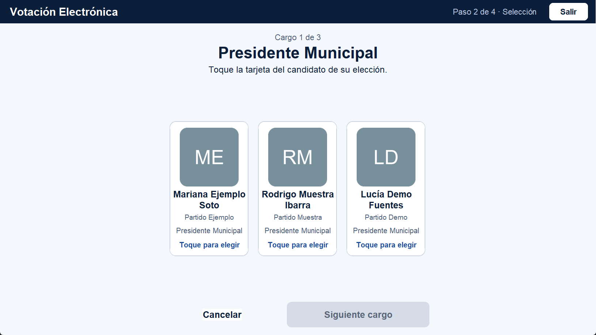
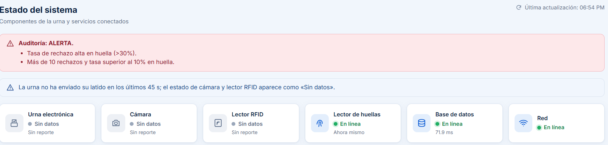

# 05 · Usabilidad

La urna acompaña a la persona votante de la identificación al resultado. El panel web está dirigido al personal que supervisa la casilla y consulta agregados. Los datos y controles de cada interfaz corresponden a ese uso. [Pantallas de urna](../kiosk_ui/ui/app_window.py) · [Rutas del panel](../dashboard/src/App.tsx)

## Urna de votación

| Pantalla | Elementos y acciones | Validación y respuesta |
| --- | --- | --- |
| Bienvenida | Instrucción para acercar la tarjeta. En demo aparecen selector de escenario, **Simular tarjeta** y **Salir**. | En modo real, el controlador consulta el bloqueo y solicita lectura al lector. Si la API no responde, informa el problema de arranque. |
| Identificación | Indicadores para tarjeta, huella y reconocimiento facial, texto del paso, animación y **Cancelar**. | Ante un fallo aparece **Reintentar** o **Intentar de nuevo**, con saldo de intentos cuando la API lo ofrece. El controlador guarda el progreso que corresponde a la sesión. |
| Identidad verificada | Confirmación neutra y **Continuar**. | La pantalla omite los datos personales del votante. **Continuar** inicia la carga de la boleta. |
| Preparación de boleta | Mensaje de espera y barra animada. | Si el backend falla o falta alguna lista obligatoria, se muestra el resultado de error previo al envío. |
| Selección | Progreso por cargo, tarjetas con nombre, partido si existe, avatar o foto disponible y distintivo de selección. | Exige elegir una candidatura para avanzar. Permite retroceder y corregir la selección, con confirmación al cancelar desde el primer cargo. |
| Revisión y envío | Tres filas de resumen, **Cambiar**, **Cancelar** y **ENVIAR VOTO**. El diálogo ofrece **Regresar** y **Sí, enviar voto**. | **Cambiar** abre el cargo concreto. Confirmar envía la selección una vez. Durante el envío se desactivan controles y aparece un indicador de espera. |
| Resultado | Mensajes diferenciados de confirmación, rechazo, incertidumbre y error anterior a la boleta. **Finalizar** vuelve al inicio. | El éxito vuelve al inicio en 10 s si no se pulsa **Finalizar**. La UI admite mostrar un comprobante del servicio. El backend actual devuelve `voteRecorded` sin comprobante y la demo sí puede mostrar uno. |
| Bloqueo | Motivo, identificador y estado de la evidencia, además de indicaciones para esperar una tarjeta administrativa. | El operador presenta una tarjeta enrolada. La API registra el desbloqueo válido. Si falla el envío de evidencia o la tarjeta no está autorizada, la pantalla mantiene el bloqueo y muestra el estado. |

### Capturas del recorrido en demo

Capturas de la ventana ejecutada con adaptadores simulados en Windows. Los nombres, partidos y comprobante pertenecen al escenario ficticio. [Escenarios de demo](../kiosk_ui/adapters/mock.py) · [Alcance de la ejecución](12-pruebas-evidencias.md)

| Momento | Captura |
| --- | --- |
| Inicio | [Bienvenida y selector de escenario](capturas/urna-inicio.png) |
| Identidad | [Confirmación de identidad](capturas/urna-identidad.png) |
| Boleta | [Selección municipal con avance deshabilitado](capturas/urna-seleccion.png) |
| Revisión | [Resumen antes de confirmar](capturas/urna-revision.png) |
| Resultado | [Voto confirmado por el simulador](capturas/urna-confirmacion.png) |

## Panel web

| Vista | Controles e información | Respuesta observada en código |
| --- | --- | --- |
| Inicio de sesión | Campo de contraseña y botón de ingreso. | Campo obligatorio, envío en curso, mensaje de credencial incorrecta o espera por intentos excedidos. |
| Inicio | Tarjetas de urna, cámara, RFID, huella, base y red, alertas y tabla de eventos recientes. | Los estados muestran texto, icono y color. El botón de expansión cambia la cantidad consultada. Un latido vencido afecta la vigencia de la información. |
| Resultados | Selector de cargo, selector de estado cuando corresponde, votos, porcentajes, participación y mapa. | Consulta por filtros. Los porcentajes por candidatura se calculan dentro de cada grupo del mismo cargo y región. |
| Reportes | Rango de fechas y pestañas **Participación**, **Resultados**, **Dispositivos** y **Votos por área**. | Muestra serie, pronóstico, tablas y descargas según pestaña. El rango se aplica a series y eventos, entre otras consultas temporales. Los agregados de resultados y participación permanecen globales. |
| Participación, Dispositivo y Configuración en el menú lateral | Entradas visibles que abren `Placeholder`. | Sus pantallas propias están pendientes. La participación se consulta desde Resultados o Reportes y los componentes desde Inicio. |
| Menú Administrador | **Cerrar sesión**. | Cierra la sesión del navegador y vuelve al ingreso. Una respuesta 401 durante las consultas protegidas también devuelve al ingreso. |

La captura del panel ya estaba en el proyecto. Muestra una alerta, un aviso por falta de latido de la urna y el estado de los componentes. La procedencia de los datos y las condiciones de la captura no quedaron registradas en el archivo. [Vista Inicio](../dashboard/src/pages/Overview.tsx)

## Evaluación de la interfaz

- La urna usa textos de acción en español, pasos numerados, iconos y color para estados, controles amplios y una selección destacada con texto. El diálogo final y el bloqueo durante el envío ayudan a evitar votos accidentales.
- La urna utiliza clic sobre tarjetas de candidatura. La revisión no aporta evidencia de un recorrido completo por teclado o con lector de pantalla. Conviene medir legibilidad, contraste y tamaño efectivo de controles en la pantalla táctil elegida y probar una operación completa con usuarios nuevos.
- El panel usa etiquetas, roles ARIA en varias vistas, estados de carga y avisos de datos desactualizados. El código implementa un menú compacto y actualización periódica. Se mantiene la última información conocida cuando una consulta falla. Conviene comprobar navegación por teclado, enfoque del diálogo o menú, lectura de gráficos y comportamiento en pantallas pequeñas.
- El menú administrativo muestra enlaces a vistas preparatorias. Una mejora sería indicar su disponibilidad en la navegación y aclarar el alcance temporal de cada reporte junto a sus controles. [Tema de urna](../kiosk_ui/ui/theme.py) · [Sondeo del panel](../dashboard/src/hooks/usePolling.ts) · [Navegación](../dashboard/src/components/Shell.tsx) · [Reportes](../dashboard/src/pages/Reports.tsx)

El recorrido con decisiones y recuperación está en la [guía de usuario](10-guia-usuario.md).
