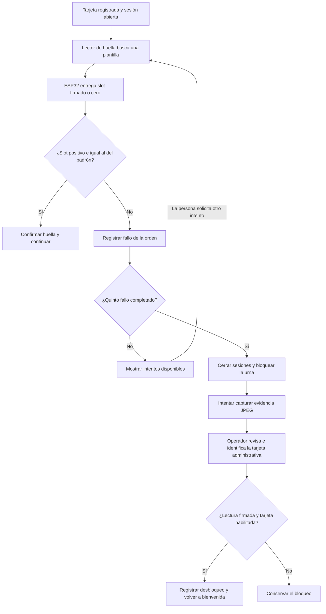

# 06 · Inteligencia y decisiones basadas en datos

El sistema usa lecturas físicas para decidir si abre la boleta y datos operativos para advertir cuándo conviene revisar una urna. La coincidencia biométrica, el bloqueo y la analítica son automáticos una vez obtenidos los datos. El desbloqueo y la investigación de alertas requieren intervención humana. [Reglas del backend](../backend.py) · [Analítica administrativa](../dashboard_api.py)

| Fuente | Dato y tratamiento | Dónde queda | Decisión |
| --- | --- | --- | --- |
| PN532 | UID hexadecimal de una tarjeta. El adaptador acepta la respuesta firmada y la API normaliza el texto. | UID previamente enrolado en el padrón. La sesión referencia al votante. | Abre la sesión si la tarjeta está registrada, el votante está habilitado y todavía puede votar. |
| R307 o AS608, según hardware | El lector convierte la imagen y busca una plantilla. El ESP32 devuelve un slot positivo o cero si falla. | Plantilla en el sensor. Slot de padrón y resultados de órdenes en la base. | Confirma la huella solo si el slot es el del votante asociado. Cinco fallos completados bloquean la urna. |
| Cámara | El cuadro se reduce, se convierte a RGB y se procesa con OpenCV y `face_recognition`. Se requiere un rostro. La comparación usa distancia euclidiana entre vectores de 128 valores. | Plantilla AES-256-GCM en el padrón. El cuadro de verificación se procesa localmente. La sesión guarda desafío, estado e intentos. | Valida un resultado vinculado a la sesión. El umbral facial predeterminado es 0.55. El margen de ambigüedad de 0.05 aplica si existen varios registros comparables. El flujo normal recibe uno. |
| Cámara ante bloqueo por intentos | El controlador intenta capturar un cuadro JPEG para el incidente. | `incidentphoto`, con acceso administrativo y plazo de retención. | Aporta evidencia para revisión humana. La indisponibilidad de cámara se registra y el bloqueo permanece. |
| API y latidos | Marcas temporales, clase y resultado de operaciones, y estado comunicado por componentes. | `dashboardevent`, `deviceheartbeat` y última secuencia de huella. | Resume disponibilidad, calcula tasas de rechazo y detecta aumentos operativos. |

Las fallas de captura facial, como ausencia de rostro, encuadre múltiple o cámara no disponible, pueden terminar en un mensaje de reintento sin reportar una coincidencia negativa al backend. Un resultado facial negativo aceptado por la API sí consume un intento. El reconocimiento usa una biblioteca preexistente y reglas de distancia. El repositorio no entrena un modelo facial ni implementa detección de vida robusta. [Captura y comparación](../face_local.py) · [Adaptador biométrico](../kiosk_ui/adapters/real/biometrics.py) · [Pruebas faciales](../tests/test_face.py)

## Alertas operativas

- `getAnalytics` ofrece un resumen histórico de órdenes de huella completadas. Declara alerta si el cociente de fallos redondeado supera 30 % y hay al menos cinco órdenes. También añade una bandera desde diez fallos. La consulta carece de filtro temporal.
- El panel calcula conteos por tipo y por rango de fechas sobre sus eventos técnicos. Suma rechazos y errores para la tasa general. Muestra alerta para huella o rostro si hay al menos cinco eventos y la tasa supera 30 %. También añade una bandera si hay al menos diez fallos y la tasa supera 10 %.
- Para una ráfaga, `_biometric_burst_flags` compara los últimos 10 minutos con los 60 anteriores. Exige al menos ocho observaciones y cuatro rechazos recientes, 20 observaciones en la referencia, un aumento de al menos 15 puntos porcentuales y separación entre intervalos de Wilson al 95 %. Solo cuenta `ok` y `rejected`. El panel usa esta regla cuando el rango incluye la ventana reciente y reutiliza su resultado hasta 60 s.
- Las alertas describen observaciones estadísticas. Sirven para revisar lecturas, iluminación o estado de la urna. El tablero tampoco identifica a una persona mediante estos eventos. [Resumen histórico](../backend.py) · [Alertas de panel](../dashboard_api.py) · [Pruebas de ráfagas](../tests/test_dashboard.py)

## Caso práctico

Un votante presenta su tarjeta registrada, pero el lector devuelve un slot distinto del asignado. FastAPI registra una orden fallida, y la urna muestra el mensaje y los intentos disponibles. Si la persona acumula cinco fallos completados, el sistema cierra las sesiones abiertas y bloquea nuevas operaciones. Una persona autorizada puede revisar el incidente y restablecer la urna usando una tarjeta administrativa enrolada. El escenario es un ejemplo de funcionamiento respaldado por la integración con resultados de huella simulados. [Regla y bloqueo](../backend.py) · [Integración de seguridad](../tests/test_security_kiosk.py)

## Pronóstico de participación

La API configura una ventana de apertura y cierre y comprueba que el número total de eventos `vote/ok` coincida con el número de personas marcadas como participantes. Cuando no coincide, responde `incomplete_history`. Con historial consistente, filtra marcas de la ventana y ajusta con NumPy una curva logística a las llegadas de votantes. Usa conteos por intervalos de aproximadamente cinco minutos, búsqueda por máxima verosimilitud, remuestreo y simulación de llegadas futuras para estimar un intervalo nominal de 80 %. Los puntos proyectados se limitan al padrón y el panel muestra la serie observada junto a la proyección cuando está disponible. [API de pronóstico](../dashboard_api.py) · [Modelo](../forecast.py) · [Componente de visualización](../dashboard/src/components/ForecastPanel.tsx)

Se necesitan al menos 100 votos observados y 60 min para intentar el ajuste. El modelo omite la cifra central si el ajuste aún es inmaduro o si el rango final excede 30 puntos porcentuales. Después del cierre devuelve la participación observada. `baseline_recent_rate` existe como referencia para pruebas y el endpoint usa `fit_turnout`. El pronóstico estima participación y no distribuye votos por candidatura. Sus supuestos no cubren cambios atípicos como una interrupción prolongada. [Pruebas del modelo](../tests/test_forecast.py)

## Propuesta no implementada

Evaluar las reglas de alerta con jornadas simuladas y fallos etiquetados por el operador. Los eventos actuales permiten medir falsas alarmas y tiempo hasta la advertencia. Vincular la revisión con la disponibilidad reportada de la cámara o del PN532 ayudaría a distinguir un aumento de rechazos de un problema operativo sin guardar nuevos datos biométricos.
