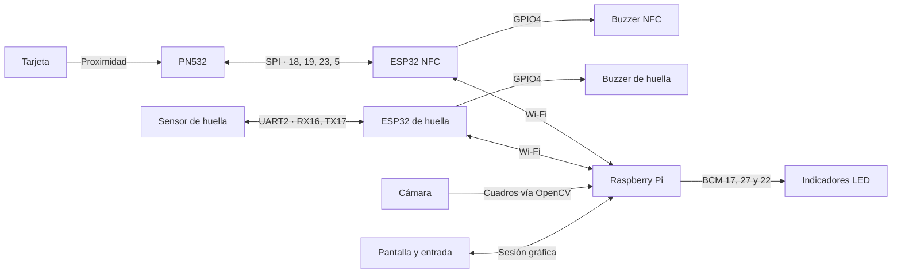

# 07 · Sensores, actuadores y conexiones

El prototipo tiene tres tipos de entrada física documentados y dos tipos de salida controlada. Los GPIO y las interfaces que aparecen aquí se pueden cotejar con los sketches y el código de la Pi. El montaje, voltajes exactos de los módulos instalados y funcionamiento de las salidas requieren evidencia física. [Guía de cableado existente](CONEXIONES_HARDWARE.md)

## Inventario

| Componente | Modelo | Tipo | Función | Dispositivo conectado | Estado |
| --- | --- | --- | --- | --- | --- |
| Computadora de urna | Raspberry Pi 5 en la guía de cableado | Controlador y anfitrión | Ejecuta la urna, la cámara y FastAPI en el despliegue previsto. | Cámara, pantalla, LED, red | Configuración prevista, placa física sin verificar. |
| Controlador NFC | ESP32, variante exacta sin confirmar | Microcontrolador | Atiende escaneo HTTP, controla PN532 y buzzer. | PN532, buzzer, Wi-Fi | Firmware normal y `_Tec` disponibles. |
| Controlador de huella | ESP32, variante exacta sin confirmar | Microcontrolador | Consulta órdenes, conecta el lector y reporta resultados. | Sensor de huella, buzzer, Wi-Fi | Firmware normal y `_Tec` disponibles. |
| Lector de tarjetas | PN532 | Sensor o lector de proximidad | Detecta tarjeta por radio y obtiene UID digital. | ESP32 NFC | Ruta de firmware y contrato simulado. |
| Lector biométrico | R307 o AS608, modelo instalado sin confirmar | Sensor de huella | Captura la impresión y busca una plantilla interna. | ESP32 de huella | Ruta firmware y slot probado con resultados simulados. |
| Cámara | Modelo e interfaz física por confirmar | Sensor de imagen | Captura cuadros para reconocimiento y evidencia. | Raspberry Pi | Adaptador OpenCV y pruebas con dobles. |
| Indicadores luminosos | Tres LED, modelo sin confirmar | Actuadores luminosos | Indican tarjeta, huella y rostro validados. | Raspberry Pi | Llamadas GPIO presentes, sustitución silenciosa si falla `gpiozero`. |
| Indicador sonoro NFC | Buzzer, modelo sin confirmar | Actuador acústico | Dos sonidos al obtener un UID aceptado por el lector. | ESP32 NFC | Control por código en ambas variantes. |
| Indicador sonoro de huella | Buzzer, modelo sin confirmar | Actuador acústico | Señala orden, éxito o fallo; incluye prueba por serie. | ESP32 de huella | Control por código en ambas variantes. |
| Tarjetas | ISO 14443 A según la configuración de lectura, modelo sin confirmar | Identificadores pasivos | Proveen UID de votante o administrador. | PN532, por proximidad | Contrato probado con UID sintético. |
| Pantalla y entrada | Modelo y conexión sin confirmar | Periférico de interfaz | Presenta la boleta y recibe acciones por toque o clic. | Raspberry Pi | Widgets y controles disponibles. Montaje táctil pendiente. |
| Red local | Punto de acceso sin modelo fijado | Infraestructura de comunicación | Conecta ESP32, Pi y navegador según el despliegue. | Equipos de la casilla | Conectividad física pendiente de validación. |

El PN532 detecta la respuesta de una tarjeta en su campo de radiofrecuencia y obtiene el identificador mediante la biblioteca Adafruit. En el lector de huella, `getImage`, `image2Tz` y `fingerFastSearch` convierten la lectura y devuelven un slot. La cámara produce imágenes y la Pi aplica verificación facial. Estos tres dispositivos adquieren información física. Los LED convierten la orden GPIO en luz y los buzzers producen sonido. La interfaz gráfica y la tarjeta se documentan como periférico e identificador, respectivamente. [NFC](../firmware/nfc_esp32/nfc_esp32.ino) · [Huella](../firmware/fingerprint_esp32/fingerprint_esp32.ino) · [Cámara](../face_local.py)

## ESP32 NFC y PN532

| Señal del ESP32 | Módulo | Dirección o condición |
| --- | --- | --- |
| GPIO18 | PN532 SCK | Reloj hacia el lector. |
| GPIO19 | PN532 MISO | Datos del lector al ESP32. |
| GPIO23 | PN532 MOSI | Datos del ESP32 al lector. |
| GPIO5 | PN532 SS/CS | Selección del lector. |
| GND | PN532 GND y retorno del buzzer o su controlador | Referencia común. |
| Alimentación según fabricante | PN532 VCC/VIN | Confirmar con el módulo concreto. |
| GPIO4 | Señal del buzzer | Pulsos de 200 µs alto y 200 µs bajo. Dos ráfagas de 80 y 120 ms separadas por 50 ms. |

Seleccione SPI en los puentes o interruptores del PN532 según su placa. El sketch no asigna IRQ o reset. El aviso acústico confirma la lectura del UID en el lector y sucede antes de que el padrón confirme la identidad. [Firmware normal](../firmware/nfc_esp32/nfc_esp32.ino) · [Firmware Tec](../firmware/nfc_esp32_Tec/nfc_esp32_Tec.ino)

## ESP32 de huella

| Señal del ESP32 | Módulo | Dirección o condición |
| --- | --- | --- |
| GPIO16 · UART2 RX | TX del lector | Datos del lector al ESP32. |
| GPIO17 · UART2 TX | RX del lector | Datos del ESP32 al lector. |
| GND | GND del lector y retorno del buzzer o su controlador | Referencia común. |
| Alimentación según fabricante | VCC del lector | Confirmar tensión, corriente y pin del modelo instalado. |
| GPIO4 | Señal del buzzer | Nivel digital alto/bajo en normal. `analogWrite(120)` y `analogWrite(0)` en `_Tec`. |

El sensor trabaja por UART2 a 57 600 baudios, 8N1. El monitor serie para diagnóstico usa 115 200 baudios. GPIO16 y GPIO17 deben estar disponibles en la placa elegida. La rutina del buzzer indica recepción de orden, éxito de verificación reportado por el backend y fallos. El menú serie ofrece una prueba sonora. [Firmware normal](../firmware/fingerprint_esp32/fingerprint_esp32.ino) · [Firmware Tec](../firmware/fingerprint_esp32_Tec/fingerprint_esp32_Tec.ino)

## Raspberry Pi

| Salida o interfaz | Conexión | Activación o uso |
| --- | --- | --- |
| BCM 17, pin físico 11 | Resistencia en serie y ánodo del LED de tarjeta | `NfcCardReader.wait_for_card`, después de abrir sesión. |
| BCM 27, pin físico 13 | Resistencia en serie y ánodo del LED de huella | `FingerprintVerifier`, tras confirmación de FastAPI. |
| BCM 22, pin físico 15 | Resistencia en serie y ánodo del LED facial | `FaceVerifier`, tras confirmación de FastAPI. |
| GND, por ejemplo pin físico 14 | Cátodos de los LED | Retorno de las tres salidas. |
| Cámara | Interfaz física por verificar | OpenCV abre `CAMERA_INDEX`, valor predeterminado 0. |
| Pantalla y control | Interfaces físicas por verificar | Sesión gráfica y eventos de clic de CustomTkinter. |

La guía previa propone 330 Ω por LED como referencia para el montaje. Confirme polaridad, valores y límites con las piezas instaladas. Use placa apagada al cablear, compruebe GND común y mida la compatibilidad de niveles antes de conectar una salida a GPIO de 3.3 V. Para un buzzer que supere la capacidad de salida, use un controlador adecuado para el modelo. `gpiozero` no figura en `requirements.txt` y debe estar disponible en la Pi para activar los LED. [Control GPIO](../kiosk_ui/led_control.py) · [Adaptadores](../kiosk_ui/adapters/real) · [Cableado previo](CONEXIONES_HARDWARE.md)

El diagrama es lógico. El orden de conectores, VCC, retorno, resistencias y controlador de potencia se verifican con el montaje. La interacción temporal con el software figura en la [secuencia de votación](03-sistemas-digitales.md).

## Evidencia para la rúbrica

| Función | Evidencia confirmada | Verificación que falta |
| --- | --- | --- |
| Sensado NFC | Sketch SPI, condición de lectura y prueba HTTP con simulador. | Tarjeta física, longitudes de UID, conexión y lectura del PN532. |
| Sensado de huella | Sketch UART, enrolamiento/búsqueda y aceptación de slots en pruebas. | Captura y comparación con un R307/AS608 físico. |
| Sensado de imagen | Apertura OpenCV, pruebas de ausencia o múltiples rostros y cámara simulada. | Captura fiable y coincidencia en la cámara y la Pi instaladas. |
| Actuación luminosa | Funciones `on/off` y condiciones de activación en adaptadores. | Salida de BCM y encendido real de cada LED. |
| Actuación acústica | Patrones y condiciones en los dos firmware, con diagnóstico serie para huella. | Grabación o prueba audible de ambos buzzers y confirmación de señal. |

El repositorio acredita el diseño e integración por código de más de dos entradas y de dos tipos de actuación. La evidencia disponible no demuestra por sí sola el requisito de **dos sensores y dos actuadores funcionales en el montaje**. Para cerrarlo, registre una lectura de tarjeta, una de huella y la respuesta de por lo menos un LED y un buzzer con el mismo montaje. [Procedimientos](12-pruebas-evidencias.md)
