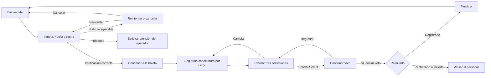

# 10 · Guía de usuario

## Emitir un voto desde la urna

1. En **Bienvenido**, acerque su tarjeta al lector y manténgala cerca hasta que la pantalla cambie. En la demostración, elija el escenario de flujo normal y pulse **Simular tarjeta**.
2. Coloque su dedo sobre el sensor cuando se lo indique la pantalla. Manténgalo quieto hasta que aparezca el siguiente paso.
3. Mire de frente a la cámara. Si aparece un mensaje de reintento, siga la indicación y pulse **Reintentar**. Si la urna se bloquea, avise al personal de casilla.
4. Al ver **Identidad verificada correctamente**, pulse **Continuar** y espere a que aparezca la boleta.
5. Seleccione una candidatura a la **presidencia municipal**, luego a la **gubernatura** y por último a la **presidencia de la República**. El botón para avanzar se activa al elegir una candidatura. Puede tocar otra tarjeta para cambiar su elección.
6. Revise las tres selecciones. Use **Cambiar** en el cargo que quiera corregir y después vuelva a la revisión.
7. Pulse **ENVIAR VOTO**. En el diálogo **Confirmar voto**, pulse **Sí, enviar voto**. Use **Regresar** si desea seguir revisando.
8. Espere el resultado. Si aparece **Su voto fue registrado**, pulse **Finalizar** o espere a que la urna vuelva al inicio. Si aparece **No se pudo confirmar el registro**, avise al personal antes de intentar votar de nuevo. [Pantallas](../kiosk_ui/ui/app_window.py) · [Capturas](05-usabilidad.md)

## Resolver una interrupción

- Para salir durante la identificación, pulse **Cancelar**. Desde la primera selección o la revisión, pulse nuevamente si la interfaz pide confirmar la cancelación.
- Si la urna vuelve a bienvenida por inactividad antes del envío, reinicie con la tarjeta. La espera predeterminada es de 120 s mientras la identificación, selección o revisión está activa.
- Si la pantalla indica **Dispositivo bloqueado por seguridad**, el operador revisa el motivo y presenta una tarjeta administrativa habilitada al PN532. Si sigue bloqueada, revise el mensaje de la pantalla. Ante un envío incierto, el operador comprueba el estado del registro con el entorno administrativo antes de autorizar otro intento. [Bloqueo](SEGURIDAD_KIOSK.md)

## Consultar el panel web

1. Abra la dirección del panel que indicó el operador y escriba la contraseña administrativa.
2. En **Inicio**, revise los indicadores de equipos y los registros recientes. **Sin datos** indica falta de un reporte vigente o disponible, según el componente.
3. En **Resultados**, elija el cargo y el estado cuando se ofrezca. Los gráficos y el mapa muestran datos agregados.
4. En **Reportes**, use las pestañas para explorar participación, resultados, dispositivos o votos por área. Ajuste las fechas al revisar series o eventos. Use **Exportar CSV** o **Exportar bitácora CSV** en las vistas que ofrecen descarga.
5. Abra **Administrador** y seleccione **Cerrar sesión** al terminar. [Navegación](../dashboard/src/components/Shell.tsx) · [Reportes](../dashboard/src/pages/Reports.tsx)
