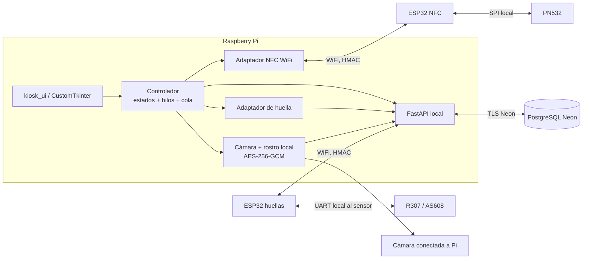

# Arquitectura y flujo

## Diagrama de componentes



Hay **dos ESP32 independientes**. USB/serie/Bluetooth no se usan entre la Pi y las ESP32. El UART de la ESP32 de huellas termina en su propio sensor y no es un canal hacia la Raspberry Pi.

## Flujo obligatorio

```mermaid
sequenceDiagram
    actor V as Votante
    participant U as kiosk_ui
    participant N as ESP32 NFC
    participant B as FastAPI
    participant F as ESP32 huella
    participant C as Rostro local
    participant D as Neon

    U->>N: Orden scan firmada + sesión + nonce + secuencia + expiración
    N->>N: Validar HMAC, nonce, secuencia y plazo; leer UID
    N-->>U: Resultado firmado y vinculado a la orden
    U->>B: Iniciar sesión con UID validado
    B->>D: Tarjeta, habilitación y voto previo
    U->>B: Crear orden de huella de un solo uso
    F->>B: Consultar orden con petición firmada
    B-->>F: Orden firmada
    F->>F: Capturar y buscar en registros del sensor
    F->>B: commandId + slot + HMAC + nonce + secuencia
    B->>D: Comparar slot con votante y consumir orden atómicamente
    U->>B: Solicitar desafío facial
    B-->>U: Desafío + solo el envelope del votante de sesión
    U->>C: Captura local, exactamente un rostro, descifrado y distancia
    C-->>B: Decisión con atestación HMAC de sesión/desafío
    B-->>U: Identidad validada
    U->>V: «Identidad verificada correctamente»
    U->>B: Cargar boleta
    B->>D: Filtrar por estado y municipio
    B-->>U: Mayor → Governor → President
    U->>V: Selección y revisión; nada se envía aún
    V->>U: ENVIAR VOTO
    U->>B: Una sola petición por sesión
    B->>D: Transacción, validación y claim atómico hasVoted=false
    B-->>U: voteRecorded
    U->>V: Confirmación solo con respuesta válida
```

## Límites de confianza y privacidad

- La interfaz nunca recibe nombre, UID, slots, embeddings ni fotografías para mostrar.
- Las imágenes faciales permanecen en memoria de captura y no se escriben a disco.
- Neon almacena envelopes AES-GCM, no la clave facial.
- Los votos no contienen referencia de votante o sesión; los logs técnicos no incluyen selecciones ni identidad.
- Si el envío queda incierto, no hay reintento automático ni botón de reenvío.
- La cancelación local intenta cerrar la sesión; el vencimiento backend es la barrera adicional.
